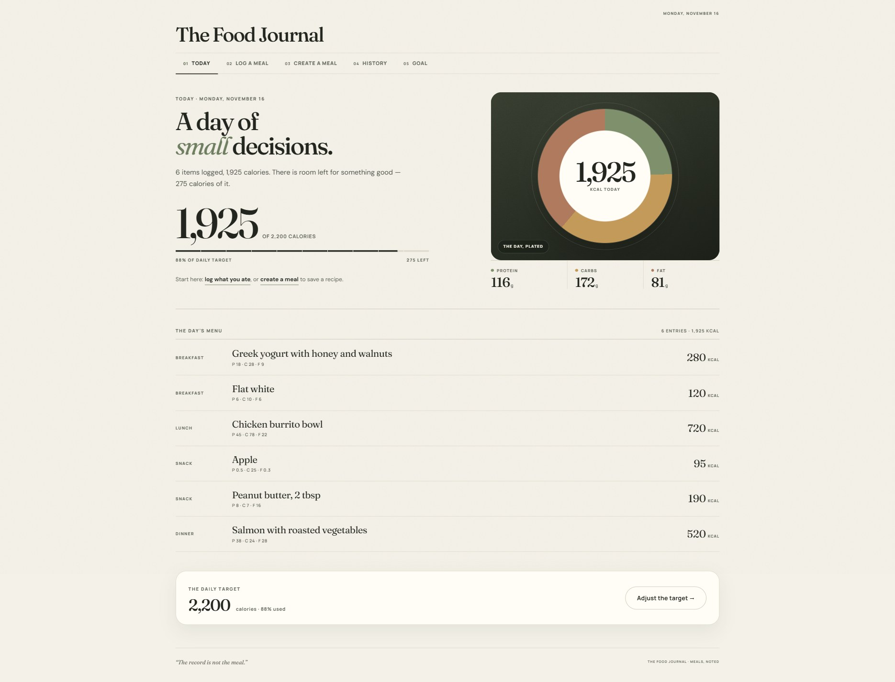
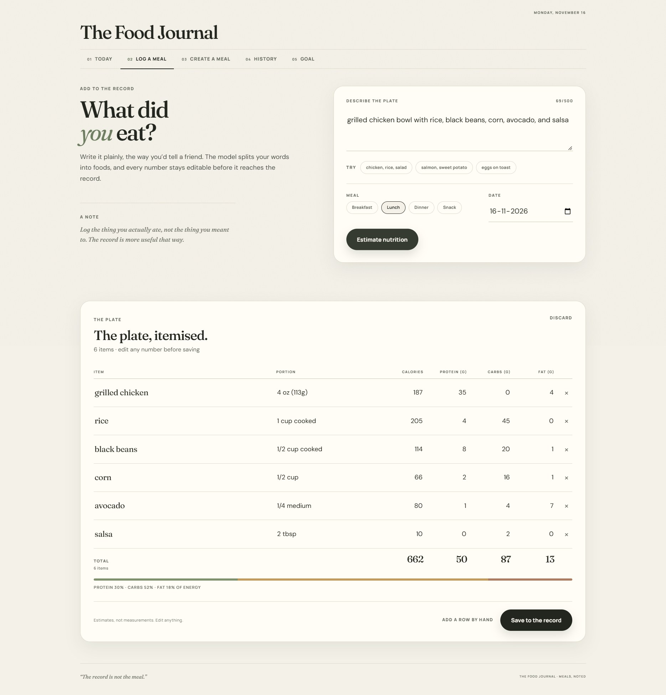
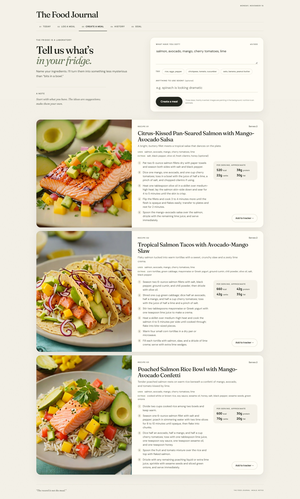
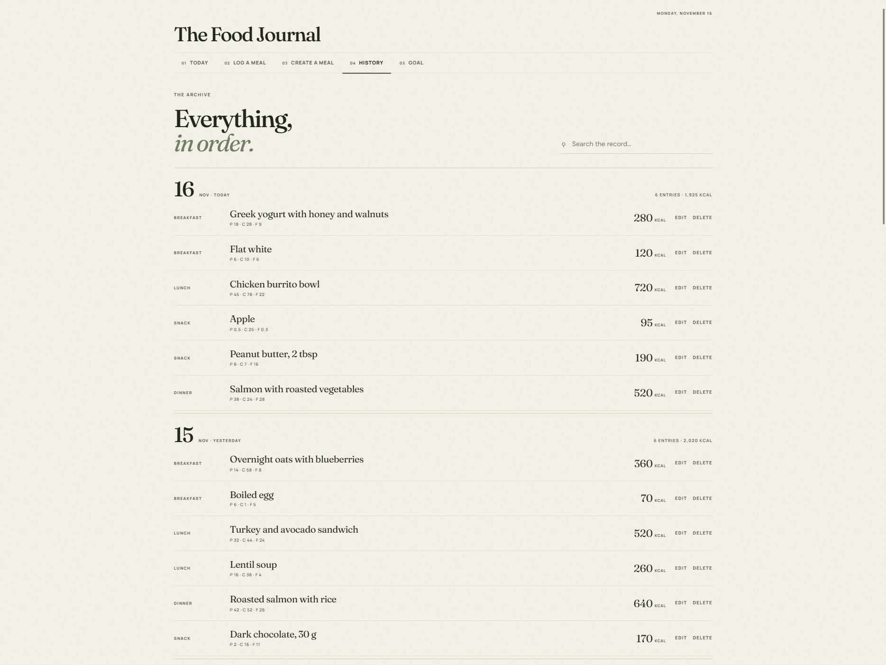

# The Food Journal

**A daily food journal, with LLM nutrition and recipe estimation**

Turn free text about food into structured, validated nutrition data. A prompt-first web app with optional AI estimation and recipe generation from OpenRouter or any local OpenAI-compatible model.

<p align="center">
  
</p>

<p align="center"><sub><b>Today.</b> Calories against the goal, macros plated, and the day's menu — one record, read at a glance.</sub></p>

Jump to: [Features](#features) · [File layout](#file-layout) · [Tech stack](#tech-stack) · [Quick start](#quick-start) · [Configuration](#configuration) · [Web interface](#web-interface) · [Journals](#journals) · [Local models](#local-models-no-cloud-calls) · [Tests](#tests) · [Model evaluation](#model-evaluation)

## Features

- **Today** — calories against your goal, a macro ring and protein/carbs/fat totals, the day's menu, and an editable daily target
- **Log a meal** — describe a meal in one line and get one editable row per food, with server-recomputed totals (`/api/parse`)
- **Create a meal** — list ingredients and get three recipe ideas with per-serving macros and optional local images (`/api/leftover-alchemist`); any idea can be seeded into the meal log for review
- **History** — every entry grouped by day with per-day totals, search, and edit or delete per entry
- **Manual entry** — add a row by hand when you already know the numbers, or when the model is unreachable
- Every parsed name and number stays editable, and failures surface as typed messages with a retry
- Each browser gets its own journal, kept in MongoDB Atlas and reached with an id this browser holds (`app/journal/store.py`)
- A committed evaluation harness scores `/api/parse` against reference calorie ranges

## File layout

The application is a package (`app/`) with the browser app under `web/`. Each folder owns one concern, so a change to recipes does not sit in the same file as a change to static routes.

```text
app/
  config.py            paths, request limits, typed settings, live .env reload
  logging_config.py    rotating model and image logs
  main.py              FastAPI factory, router wiring, server entry point
  journal/store.py     per-browser journals: validation, Mongo documents, revision guard
  services/            llm.py, nutrition.py, recipes.py, images.py, transport.py
  web/
    dependencies.py    JSON body rules, same-origin guard, journal/LLM helpers
    http.py            one JSON response shape, API headers, exception handlers
    schemas.py         Pydantic request/response models behind /docs
    static.py          /assets mount plus explicit page and legacy asset routes
    routers/           health.py, runtime.py, journal.py, ai.py, images.py
web/
  pages/               nutriparse.html, food-journal.html
  css/nutriparse/      base, compose, results, recipes, journal
  css/food-journal/    base, layout, compose, journal, responsive, fonts
  js/nutriparse.js     Compose module: DOM refs, state, copy, mode and view switches
  js/nutriparse/       boot entry plus request, estimate, recipes, inspector, journal, samples
  js/food-journal.js   Food Journal module entry: today, compose, history, goal, alchemist
  js/journal-store.js  shared journal API as ES modules; both pages import it
  js/config-client.js  server-driven AI timeouts, kept as a classic script for the Node test
  js/config-module.js  ES-module interface to config-client.js
  fonts/               self-hosted woff2 for the Food Journal, with OFL licences
scripts/
  seed_demo.py         seeds the nutriparse_demo database with demo entries
  setup_image_generator.bat / start_image_generator.bat  CUDA image service
  start_llm.bat        starts a local llama.cpp server with the expected settings
tests/                 store, asset-link, settings, FastAPI, browser config-loader, and JS type-check tests
evals/                 parse evaluation harness, fixtures, and committed results
screenshots/           the screenshots used in this README
requirements.txt       backend dependencies (FastAPI, Uvicorn, pydantic-settings, httpx, pymongo)
requirements-dev.txt   adds mongomock for the store tests
package.json            dev-only Node manifest for the JavaScript type check
tsconfig*.json          TypeScript options and script graphs for both pages
image-cache/           generated recipe PNGs keyed by content hash (ignored by Git; delete to clear)
```

New files are served from `/assets/`, which mounts only `web/`; source, `.env`, and journals stay outside the reachable tree. The public URLs are stable: the Food Journal at `/` and `/food-journal.html`, the older Compose page at `/nutriparse.html`, and `/nutriparse.css`, `/journal-client.js`, and `/food-journal.css` as compatibility aliases.

## Tech stack

| Layer | What The Food Journal uses |
| --- | --- |
| Language | Python 3.10+ for the API, store, and evaluation harness; vanilla JavaScript in the browser |
| Backend | FastAPI on Uvicorn, with Starlette and Pydantic underneath; one shared `httpx` async client for provider calls |
| Frontend | HTML5, CSS, and plain JavaScript — no framework, bundler, or build step |
| LLM providers | OpenRouter by default; any OpenAI-compatible endpoint for local inference — Ollama, llama.cpp, LM Studio, vLLM |
| Image generation | stable-diffusion.cpp CUDA build serving SDXL-Turbo through an AUTOMATIC1111-compatible API |
| Persistence | MongoDB Atlas (`pymongo`), one document per browser journal, with validation and an optimistic-concurrency counter |
| Configuration | One typed `pydantic-settings` object for `.env` and the process environment, with process variables taking priority and mtime-based live reload |
| Testing | Python `unittest` for the store and routes, Node's runner for the browser config loader, and TypeScript `checkJs` for the browser scripts |

## Quick start

Python 3.10+ and a MongoDB Atlas connection string are required. Node.js 18+ is optional, only for the JavaScript type check.

```powershell
python -m pip install -r requirements.txt
cp .env.example .env      # set OPENROUTER_API_KEY and MONGODB_URI
python -m app.main
```

Open http://localhost:8100; interactive API docs are at `/docs`. `python -m app.main --demo` serves the demo journal, which `scripts/seed_demo.py` seeds with a week of sample entries. For automatic reloads, run Uvicorn directly — it skips the banner, the missing-key warning, and the `--demo` flag:

```powershell
python -m uvicorn app.main:app --reload --port 8100
```

The app still loads `.env` itself for journals, providers, and image settings, but Uvicorn does not read the `HOST`/`PORT` constants from `app/config.py`.

## Configuration

Runtime settings live in `.env` (start from `.env.example`) and are parsed into one typed `app.config.Settings` object. Process environment variables override the file, including the image options and the legacy `OPENROUTER_TOKEN` / `OPEN_ROUTER_API_KEY` aliases. The server compares the file's mtime on each request, so an edit applies to the next request without a restart. Invalid values stop startup with a message naming the setting; `LLM_TIMEOUT` is the exception and falls back to the provider default (30 s for parsing and 45 s for recipes on OpenRouter, 180 s for a local model).

`MONGODB_URI` is required and `MONGODB_DB` defaults to `calorie-tracker`. Keep the connection string in the environment or a local `.env`, never in Git; a missing URI fails startup. The client is created once at startup and closed on shutdown, with no startup ping.

Both pages read the effective parse, cook, and image timeouts from `GET /api/config` at startup, which also reports the active provider and model. Each client waits 10 seconds longer than the server's value, so a slow provider gets the server's error rather than a premature client abort. If the config call fails, AI calls use a 300-second safety net; journal reads and writes are unaffected.

Model and image calls share one `httpx` client: at most three model calls and one image generation run at a time. A 429 or 5xx response is retried up to three total attempts with 0.5 s and then 1.5 s between them; other 4xx responses are not retried. Journal writes use a revision-guarded read-modify-write that retries three times before returning 503, and cross-site writes are refused. Uvicorn runs with `--proxy-headers` and trusts `X-Forwarded-*` from the host's proxy.

## Web interface

`/` serves the Food Journal, which is the main app: Today, Log a meal, Create a meal, History, and Goal, all reading and writing the journal store. The older Compose page is still served at `/nutriparse.html`, and `/food-journal.html` is an alias for the main app.

**Today** opens on the day so far: calories against your goal with a macro ring, protein/carbs/fat totals and entry count, the day's menu itemised, and the daily target with a link to adjust it.

**Log a meal** turns a description ("grilled chicken bowl with rice, black beans, corn, avocado, and salsa") into one row per item. Every parsed name and number stays editable before it reaches the record, totals are summed from the rows you can see, and **Add a row by hand** seeds one blank row for numbers you already know.

<p align="center">
  
</p>

<p align="center"><sub><b>Log a meal.</b> One line in, one editable row per food out, totals recomputed from the rows you can see.</sub></p>

**Create a meal** turns an ingredient list into three recipe ideas with steps and per-serving macros, with images generated by the local service; any idea can be sent to Log a meal for review.

<p align="center">
  
</p>

<p align="center"><sub><b>Create a meal.</b> Three ideas from the fridge, plated with per-serving macros and steps — and one click to log a serving.</sub></p>

**History** is the read side of the same store: every entry grouped by day with per-day totals, a search box, and an edit or delete per entry. **Goal** edits the daily target with presets.

<p align="center">
  
</p>

<p align="center"><sub><b>History.</b> Every day in order, totals at a glance, each entry editable — the archive behind Today.</sub></p>

The older Compose page keeps its `?sample=1` / `?sample=cook` previews and `?view=journal` shortcut.

## Journals

Each browser owns one journal. On the first visit the page creates a 32-hex id with `crypto.getRandomValues`, stores it in `localStorage` under `np_journal_id`, and sends it as `X-Journal-Id` on every journal request. The id is the only key: clearing browser storage loses that journal, and two browsers never share one. History's **Restore or delete this journal** panel (or `?journal=<id>`) opens and manages it.

| Endpoint | Body | Returns |
| --- | --- | --- |
| `GET /api/journal` | — | the whole document; an unknown but well-formed id is created with the default goal |
| `POST /api/journal/entries` | `{"entries": [ … ]}` | the document including the new rows, each with a server-assigned id |
| `PUT /api/journal/entries/<id>` | `{"entries": [ … ]}` | the document with that row replaced; the first new row keeps the id |
| `DELETE /api/journal/entries/<id>` | — | the document without that row |
| `POST /api/journal/goal` | `{"calorie_goal": 2200}` | the document with the new goal |
| `DELETE /api/journal` | — | an empty document; only the calling journal is wiped |

Every request needs an `X-Journal-Id`; a missing or malformed one is refused with 400 rather than defaulting to another journal. `app/journal/store.py` holds the rules: validation, id assignment, lazy creation, and revision-guarded writes. Journal writes also check the request's `Origin` against its own `Host`, so an https reverse proxy works without deriving a port from the scheme. Rows saved by an earlier version in `localStorage` under `ct_data` migrate once on first load; two tabs loading at the same instant can produce duplicates.

## AI suggestions setup

AI nutrition suggestions need an OpenRouter API key. A visitor can paste their own into the app: it stays in that browser tab, is sent only with Estimate and Cook, and is gone when the tab closes. A deployment can also set `OPENROUTER_API_KEY` (and optionally `OPENROUTER_MODEL`, default `openrouter/free`) so visitors need no key; a key pasted in the app overrides it for that tab. The value is never logged or returned to the browser. Recipe images do not use this key.

### Local models (no cloud calls)

Set `LLM_PROVIDER=local` and point `LLM_BASE_URL` at any server that speaks the OpenAI `/chat/completions` API. Nothing in the backend is tied to one runtime: llama.cpp, Ollama, LM Studio, vLLM, and hosted gateways all receive the same request.

```env
LLM_PROVIDER=local
LLM_BASE_URL=http://localhost:11434/v1
LLM_MODEL=qwen3.5:4b
```

| Server | Base URL |
| --- | --- |
| Ollama | `http://localhost:11434/v1` |
| LM Studio | `http://localhost:1234/v1` |
| llama.cpp | `http://localhost:8080/v1` |
| vLLM | `http://localhost:8000/v1` |

`LLM_MODEL` is the tag for Ollama and the model ID or alias elsewhere. Local servers usually need no key; set `LLM_API_KEY` only for a gateway that enforces one.

#### llama.cpp

`scripts/start_llm.bat` wraps the server command and serves `http://localhost:8080/v1`. Install the `llama` CLI (`irm https://llama.app/install.ps1 | iex`) or a [release build](https://github.com/ggml-org/llama.cpp/releases), and put a GGUF model under `models\<name>\`. A `Q4_K_M` quant is the usual starting point — roughly 5–6 GB for a 9B model:

```powershell
llama serve -m models\qwen3.5-9b\qwen3.5-9b-Q4_K_M.gguf `
  --alias qwen3.5-9b -c 8192 -ngl 99 --host 127.0.0.1 --port 8080 `
  --jinja --reasoning off
```

Point `.env` at `http://localhost:8080/v1` with `LLM_MODEL=qwen3.5-9b` and `LLM_REASONING_EFFORT=` empty (llama.cpp does not read it). `--alias` is the name the UI reports. `-ngl 99` offloads every layer to the GPU; drop or lower it on CPU-only or tight-VRAM machines. `--reasoning off` matters with thinking models: without it Qwen3.5 spent thousands of tokens before answering, turning a 7-second parse into a 100-second one.

#### Ollama

```powershell
ollama pull qwen3.5:9b
ollama serve
```

```env
LLM_PROVIDER=local
LLM_BASE_URL=http://localhost:11434/v1
LLM_MODEL=qwen3.5:9b
```

Ollama keeps the model loaded between calls and names keep their `name:tag` form. If an older build rejects `response_format`, set `LLM_JSON_MODE=false`.

#### Tuning local inference

| Symptom | Lever |
| --- | --- |
| First call is slow, later ones are fast | Expected — the first request loads the model |
| `context overflow` or truncated JSON | Raise the context size (`-c`); 8192 leaves headroom |
| Out of VRAM | llama.cpp: lower `-ngl` or `-c`, use a smaller quant, or add quantized KV cache |
| Thinking model returns empty content | `--reasoning off` (or `LLM_REASONING_EFFORT=none` where supported) |
| HTTP 400 mentioning `response_format` | Set `LLM_JSON_MODE=false`; fenced JSON is still stripped |
| HTTP 404 from the model call | `LLM_BASE_URL` is missing `/v1` |

`LLM_TIMEOUT` overrides the request timeout (defaults: 30 for nutrition and 45 for recipes on OpenRouter, 180 for local models). Recipe images are unaffected and still use the local image service. Because `evals/results.json` is a snapshot of one model on one date, re-run the evaluation after changing the model or quant.

## Recipe images (optional, NVIDIA CUDA)

Recipe images use an AUTOMATIC1111-compatible `/sdapi/v1/txt2img` service. On an NVIDIA GPU, run `scripts/setup_image_generator.bat` once — it downloads the stable-diffusion.cpp CUDA build and Stability AI's SDXL-Turbo checkpoint (about 7.8 GB) — then start `scripts/start_image_generator.bat` before creating a meal. The service binds to `127.0.0.1:7860`, produces 640×480 images in 6 steps in a few seconds each on an 8 GB laptop GPU, and needs 20–40 seconds for its first load.

Image size and steps come from `LOCAL_IMAGE_WIDTH`, `LOCAL_IMAGE_HEIGHT`, and `LOCAL_IMAGE_STEPS`. If you replace SDXL-Turbo with a regular checkpoint such as SD 1.5, set `LOCAL_IMAGE_STEPS=20` and adjust `--cfg-scale` in the start script. The service is optional: if stopped, recipe ideas still load without images. Set `LOCAL_IMAGE_GENERATION_ENABLED=false` to disable image requests, or override `LOCAL_IMAGE_API_URL` to use another address.

Generated PNGs are cached under a SHA-256 hash of the normalized prompt, width, height, and steps, and reused by later runs. `POST /api/recipe-image` returns `{"image": "/api/recipe-image/<hash>.png", "cached": false}`, and the image route serves files with a one-year immutable cache header. Files live in `image-cache/` (ignored by Git); delete that directory while the server is stopped to clear it.

Text-model requests are logged to `logs/llm.log` and image requests to `logs/image_generation.log`, with request ID, duration, and outcome. Failed calls also record the upstream status and a truncated, sanitised error excerpt; prompts are not logged on success, and credentials and image data are never logged. Each log rotates at 2 MB, keeping five backups.

## Tests

The journal store runs against `mongomock`, with no database server needed: validation, portions, lazy creation, legacy ids, malformed documents, goal changes, isolation, revision-race retries, and concurrent writers. The FastAPI suite covers the journal round trip, id validation and isolation, same-origin checks behind an https proxy, the OpenAPI schemas, `/api/config`, model-output rules, transport retries and concurrency caps, and the recipe-image cache. The browser config loader runs under Node's built-in runner and skips when Node is absent.

```powershell
python -m pip install -r requirements-dev.txt
python -m unittest discover -s tests
```

The browser code has no build step, so TypeScript's `checkJs` mode catches misspelled imports and shared globals:

```powershell
npm ci
npm run check:js
```

Each page is checked as its own ES-module graph; `tests/test_assets.py` also verifies every relative import resolves to a real file. The Node packages are development-only, and the Python test command runs the check when the tooling is installed.

## Model evaluation

`evals/` holds a committed harness that scores `/api/parse` against fixed meals with reference calorie ranges, so prompt changes can be compared and "the model under-counts" can be measured.

```powershell
python -m app.main                  # in one terminal
python evals/run_parse_eval.py      # in another
python evals/run_parse_eval.py --check-fixtures   # offline: validate the cases only
```

Thirteen cases, twelve with a calorie reference and one non-food refusal check. Rows that a model splits are summed before comparison, so a correct split is not punished. The runner reports within-range rate, mean signed error, mean absolute error, item detection, refusals, latency and tokens, and writes `evals/results.md` plus `evals/results.json`; see `evals/README.md` for method and limits.

The committed run is a snapshot of the local model (`qwen3.5:9b`, 21 October 2026): 10 of 12 scored meals landed inside their reference range, with a mean signed error of −4.4%. The errors concentrate in energy-dense food — two slices of pepperoni pizza at 300 kcal against 450–700 — and a meal can total in range while an item inside it is wrong: "2 rotis, dal, and a lassi" lands at 470 kcal against 420–650, with the roti row at 140 against 180–260.
